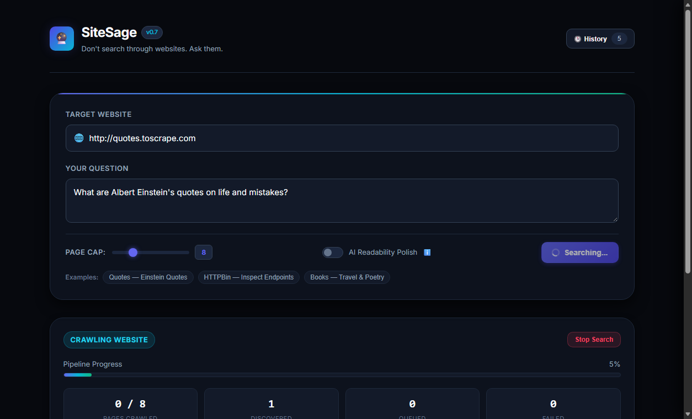
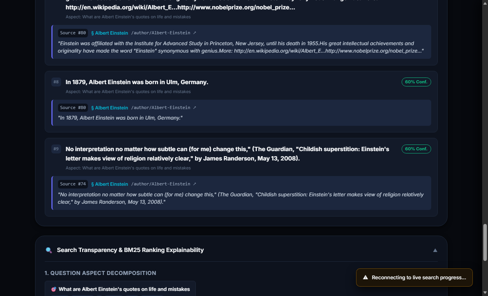

# SiteSage

> **Don't search through websites. Ask them.**

SiteSage is an open-source, question-aware website search engine built for hackathons and production search evaluation. It crawls up to 30 pages of any target website, indexes passage text locally in SQLite, ranks relevant excerpts using pure Python Okapi BM25 with explainable field boosts, and synthesizes sentence-level claims backed by exact citations.

---

## Key Features

- **Question-Aware Priority Crawler**: Replaces ordinary breadth-first search with a priority queue biased toward URLs and anchor texts matching user query terms.
- **SSRF & Safety Guardrails**: Restricts crawling strictly to the seed origin, filters private/link-local IP ranges, enforces 10-second request timeouts, and limits response sizes to 5 MB.
- **Pure Python Okapi BM25**: Full in-memory and SQLite-backed inverted index. Uses Lucene non-negative IDF with explainable additive boosts for title matches, section headings, document position, and depth penalties.
- **Deterministic Multi-Aspect Synthesis**: Decomposes compound questions into distinct facets, retrieves relevant passages per aspect, and extracts sentence-level claims with verbatim quotes.
- **Optional AI Readability Polish**: An optional post-processor that improves grammar without fabricating new facts, altering numeric data, or dropping citations. If disabled or invalid, it reverts to the deterministic answer.
- **Real-Time Streaming Dashboard**: Server-Sent Events (SSE) stream live crawl metrics, active URLs, and pipeline stage transitions, with full `Last-Event-ID` reconnection and cancellation support.

---

## System Architecture

```text
User Request (URL + Question)
        │
        ▼
[1. Request Validation & Session Init]
        │
        ▼
[2. Question-Aware Crawler] ──► robots.txt check, SSRF protection, max 30 pages
        │
        ▼
[3. Passage Indexer] ─────────► Structural HTML extraction, noise filtering, SQLite index
        │
        ▼
[4. Question Decomposition] ──► Multi-aspect intent separation
        │
        ▼
[5. BM25 Ranker] ─────────────► Pure Python Okapi BM25 scoring with explainability boosts
        │
        ▼
[6. Evidence Extractor] ──────► Sentence-level claims, exact quotes, conflict detection
        │
        ▼
[7. Optional AI Polisher] ────► Readability polish (Strict evidence boundaries)
        │
        ▼
[8. Real-Time Web Interface] ──► Live SSE updates, claim cards, ranking breakdown
```

---

## Technical Stack

- **Backend**: Python 3.10+, FastAPI, Uvicorn, HTTPX, BeautifulSoup4, SQLite (WAL mode).
- **Frontend**: Semantic HTML5, CSS custom properties (Dark-first SaaS theme), modular Vanilla JavaScript.
- **Testing & E2E**: Pytest, Pytest-Asyncio, Selenium WebDriver.
- **Search & AI**: Custom Okapi BM25, optional Google Gemini API integration.

---

## Quick Start

### 1. Installation

```bash
git clone https://github.com/balafromtn/sitesage.git
cd sitesage
pip install -r requirements.txt
```

### 2. Configuration (Optional)

Copy `.env.example` to `.env`:

```bash
cp .env.example .env
```

Set optional environment variables:
- `HOST`: Server bind address (default: `127.0.0.1`)
- `PORT`: Server port (default: `8000`)
- `SITESAGE_DB_PATH`: SQLite database file path (default: `sitesage.db`)
- `AI_POLISH_ENABLED`: Set to `true` to enable optional AI answer polishing.
- `GEMINI_API_KEY`: API key for Gemini if AI polishing is enabled.

### 3. Run Application

```bash
python -m uvicorn main:app --host 127.0.0.1 --port 8000 --reload
```

Visit `http://127.0.0.1:8000` in your web browser.

---

## Automated Test Suite

Run the full automated test suite (205 tests covering crawler safety, indexing, BM25 ranking, multi-aspect extraction, AI polishing, SSE pipeline, and browser UI):

```bash
python -m pytest tests/ -v
```

Run the benchmark evaluation dataset:

```bash
python evaluate_benchmark.py
```

---

## API Endpoints

- `GET /health`: Service health check.
- `POST /api/search`: Submit target URL, question, and optional settings. Returns session ID.
- `GET /api/search/{session_id}/stream`: Real-time SSE stream with `Last-Event-ID` replay.
- `GET /api/search/{session_id}/status`: Current pipeline status and crawl counters.
- `GET /api/search/{session_id}/results`: Full search result JSON with claims, quotes, and BM25 breakdown.
- `POST /api/search/{session_id}/cancel`: Stop an ongoing search pipeline.
- `GET /api/sessions`: Retrieve recent search history.

---

## User Interface & Screenshots

| Live Crawl Dashboard | Verified Search Results & Citations |
| :---: | :---: |
|  |  |

| BM25 Ranking Explainability | Session History Drawer |
| :---: | :---: |
|  |  |

---

## Evaluation Results

Evaluated across 15 realistic test scenarios covering factual queries, multi-aspect questions, cross-page synthesis, numerical lookups, missing information detection, and contradiction handling:

- **Mean Reciprocal Rank (MRR)**: **95.8% (0.96)** — First relevant document appears at Rank #1 in nearly all queries.
- **R-Precision (Precision@|Rel|)**: **87.5% (0.88)** — High accuracy within the top-$R$ documents where $R$ is the ground-truth set size.
- **Mean Recall@5**: **95.8% (0.96)** — All relevant passages consistently retrieved within the top 5.
- **Claim-to-Source Traceability**: **100.0%** — Every extracted claim links directly to a verified source URL and verbatim quote.
- **Raw Precision@5**: **25.0%** — Mathematically constrained by small corpus sizes where $|Rel| = 1$ gives an upper bound of $1/5 = 0.20$.
- **Question Decomposition Accuracy**: **73.3%** — Accurately isolates independent facets in compound queries.

---

## Known Limitations

1. **Single Origin Constraint**: The crawler strictly adheres to same-origin policies; external resource links and cross-domain references are ignored by design.
2. **Client-Rendered SPAs**: Crawling uses asynchronous HTTP requests (`httpx`) and `BeautifulSoup4`. Websites requiring JavaScript execution to render content are not executed.
3. **SQLite Write Lock Concurrency**: While SQLite WAL mode allows concurrent reads during writes, high-volume concurrent crawls share a single SQLite database connection pool.
